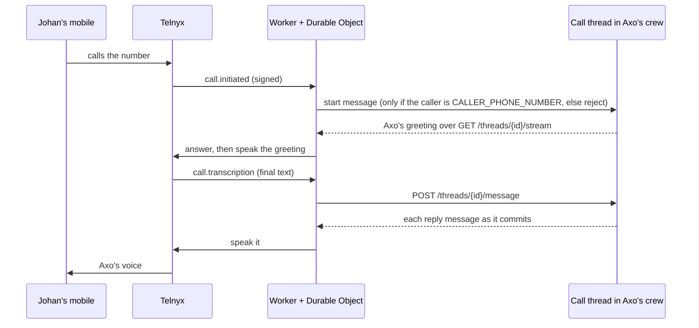

# capy-phone-bridge (Worker capy-phone-bridge)

A Cloudflare Worker and Durable Object that lets Johan talk to Axo (Captain thread GFR-4) by phone, and lets Axo phone Johan.
Telnyx Call Control does the audio (speech to text and text to speech), so the Worker only handles HTTPS webhooks. Each call gets its own Capy thread in Axo's crew, so that thread is the call history and Axo gets a summary when it ends.



## Behaviour

- Inbound: only `CALLER_PHONE_NUMBER` is answered. Any other number, and anonymous callers, are rejected with a Telnyx `reject` before anything reaches Axo.
- Every webhook is verified with Telnyx's Ed25519 signature (`telnyx-signature-ed25519`, `telnyx-timestamp`, five minute replay window). A failed check returns 401 and nothing is processed.
- A call opens with a `[Channel: Phone call] [Event: Incoming call] [From: Johan] [Time: <time>]` message naming the caller, the local time and how to talk on the phone. The phone keeps ringing until Axo's greeting lands, so the first thing Johan hears is Axo; after 20 seconds (Axo can take about 10 seconds to wake) the bridge answers with "Hey Johan." and speaks Axo's greeting when it arrives.
- What Johan says is sent as `[Channel: Phone call] [From: Johan] ...` with `interrupt` delivery, or with `steer` once Axo has started a tool in the current turn, so an "okay" during a lookup does not cancel it. The bridge reads the thread's live stream and speaks each finished sentence of Axo's reply as it is written, before the message commits, cleaned of markdown and links and cut at 700 characters. If Axo starts a tool before saying anything, a short filler plays at once. A reply that lands just after Johan says something else is still spoken. Sends to Capy time out after 3 seconds and retry once with the same client key, which Capy deduplicates.
- Speech is transcribed with Deepgram Flux. A final transcript that ends a sentence is sent after 0.4 seconds, a one- or two-word one after 0.8 seconds (on a weak line Flux splits "Axo, can you hear me?" into "Road." and "hear me?"), and one that trails off after 0.8 seconds in case he keeps talking. Finals made only of hesitations such as "um" or "hmm" are not sent. If Telnyx rejects Flux the bridge falls back to Nova-3, where a final transcript that trails off waits 1.2 seconds; interim transcripts keep the turn open while he is still talking, so a pause mid-sentence does not split it. A final transcript also wakes the open reply stream so the send is not held behind it. If he talks over Axo (two words or more, or one stop word such as "wait"), playback stops on the first interim transcript, the rest of that reply is dropped, and his words go to Axo. Single-word backchannels while Axo talks, and transcripts that match what the bridge just said, are ignored as echo.
- Each call runs in its own small Capy thread, created when the call starts in Axo's crew on `CAPY_CALL_MODEL_ID` at `CAPY_CALL_REASONING_MODE`, so replies start on a tiny context instead of Axo's full Captain thread (measured 3.9 s first reply, 2.7 s after, against 4 to 16.5 s on GFR-4). When the call ends the bridge waits five minutes before telling the thread to report a short summary to Axo, and archives it three minutes after that, or later while the thread is still working or waiting on a timer such as a promised callback.
- Dropped calls: if Johan calls back within those five minutes, or Axo's callback is answered within them, the new call continues in the same thread with a `[Channel: Phone call] [Event: Call resumed] [Gap: <gap>]` note instead of a fresh start. The note says whether he missed the end of Axo's last reply and passes on words he said just before the drop. A new call from Johan also replaces a call the bridge still has on record, since the old leg is dead, instead of being rejected. One summary covers the whole conversation. Axo's own model is never touched.
- After 40 seconds of silence Axo is asked to check in; after another 30 seconds it says goodbye and the call hangs up. Talking over Axo counts as activity, so noise that cuts Axo off does not lead to a goodbye. When Axo answers a goodbye with a line ending in `[Hang up]`, the bridge speaks the line and hangs up. When a call ends, a `[Channel: Phone call] [Event: Call ended] [Duration: <duration>] [Ended by: <who>]` message is queued in the thread.
- Hold: when Axo knows work will be long it ends a line with `[Hold]` ("Let me run the tests. [Hold]"). The bridge speaks the line without the tag and starts looping hold music if no answer lands within 4 seconds of the line. Quick answers get no music. If Axo has said nothing after 6 seconds, or starts a tool before saying anything, the caller hears one short filler such as "Let me look." per question (never on silence check-ins or the greeting), and if Axo stays quiet for 15 seconds the caller hears "Sorry, this is taking a bit. Hold on." and the music starts after it. That wait is usually Capy queueing a new call thread for a worker, which took 5 to 47 seconds on 27 Nov. The music stops when Axo's next message lands or Johan talks. After 300 seconds with no reply at all the call ends with a note that the answer will be in the thread.
- The hold music is "Local Forecast - Elevator" by Kevin MacLeod (incompetech.com), licensed under Creative Commons Attribution 4.0, served from `public/hold.mp3` as a Workers static asset.
- Hard caps: a call ends after 600 seconds (default 600) and at most 10 (default 10) outbound calls are placed per calendar day in Europe/Madrid. Rejected and unauthorized attempts do not count.
- The bridge speaks every assistant message that lands in the thread after the message it sent. If another agent wakes Axo during a call, that unrelated reply is spoken too.

## Outbound calls (how Axo phones Johan)

```bash
curl -X POST https://capy-phone-bridge.<account-subdomain>.workers.dev/call \
  -H "Authorization: Bearer $OUTBOUND_TOKEN" \
  -H "Content-Type: application/json" \
  -d '{"text": "The nightly backup failed twice.", "listen": true}'
```

- `text` (required, at most 1000 characters) is spoken when Johan answers.
- `listen` (optional, default false). When true the call stays open after the alert and whatever Johan answers is sent into a call thread with the alert as context, then Axo's reply is spoken, turn by turn. It is the previous call's thread when that call ended less than five minutes earlier, otherwise a new one. When false the call hangs up after the alert.
- `thread` (optional, a Capy thread id such as `jam_...`). With `listen`, his answer goes into that thread instead, however long ago the last call ended. A call thread passes its own id when it phones him back as promised, so a "call me in 30 minutes" stays one conversation.
- If voicemail picks up a `listen` call, the bridge recognises the greeting, speaks the alert once more for the recording and hangs up, and nothing reaches a thread.
- Responses: `202` call is being placed, `401` missing or wrong token (no call is placed), `400` bad body or thread id, `429` daily limit reached, `502` Telnyx refused the call.

The call always goes to `CALLER_PHONE_NUMBER`; the endpoint cannot dial anything else.

## Configuration

Fixed settings (caller name, time zone, voice, speech model, key terms, timings, the 600 second call cap, the 10 outbound calls per day cap and the hold music URL) are constants at the top of `src/config.ts`. Only what changes per deployment lives in `[vars]` in `wrangler.toml`:

| Variable | Meaning |
| --- | --- |
| `CAPY_PROJECT_ID` | Project the call threads are created in (GFR) |
| `CAPY_CAPTAIN_ID` | Captain the call threads report to (Axo, GFR-4) |
| `CAPY_CALL_MODEL_ID` | Model a call thread runs on, `anthropic/claude-haiku-5-5` by default |
| `CAPY_CALL_REASONING_MODE` | Reasoning in a call thread, `low` by default |
| `TELNYX_CONNECTION_ID` | Telnyx Call Control application (g4f4r0-axo) the number is assigned to |

## Secrets

Set with `wrangler secret put <NAME>` (or through the Cloudflare API). Never commit them. A secret set before the first deploy is lost, so deploy first.

| Secret | What it is |
| --- | --- |
| `TELNYX_API_KEY` | Telnyx API v2 key |
| `TELNYX_PUBLIC_KEY` | Telnyx account public key (Mission Control, Keys and Credentials, Public Key); base64 Ed25519 |
| `CAPY_API_KEY` | Capy API key that can write to and read from the call threads (Settings, API) |
| `TELNYX_PHONE_NUMBER` | The purchased Telnyx number in E.164, used as the caller id of outbound calls |
| `CALLER_PHONE_NUMBER` | Johan's mobile in E.164, the only number that is answered and the number outbound calls go to |
| `OUTBOUND_TOKEN` | Random bearer token for `POST /call`; generate with `openssl rand -hex 32` |

## Setup and deploy

1. In Telnyx create a Call Control application (webhook API version v2) whose webhook URL is `https://capy-phone-bridge.<account-subdomain>.workers.dev/telnyx/webhook`, and assign the purchased number to it.
2. `npm install` at the repository root, then `cd apps/capy-phone-bridge`
3. Set `TELNYX_CONNECTION_ID` in `wrangler.toml` and put the six secrets above with `wrangler secret put`.
4. `npm run deploy`

## Development

`npm test` runs the unit tests (signature check, caller allowlist, outbound auth, caps, call flow); `npm run typecheck` checks the types.
