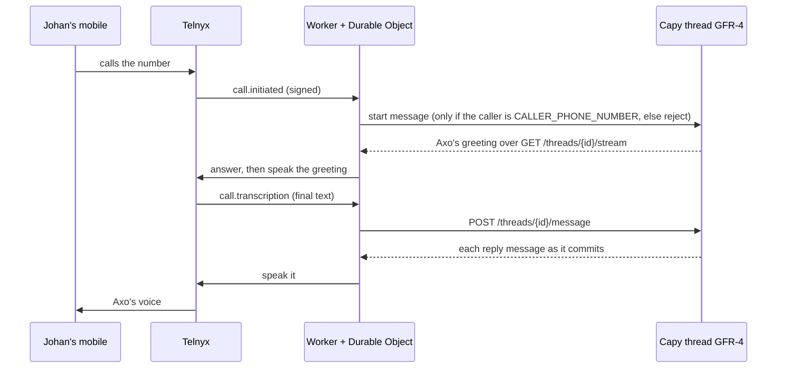

# phone-bridge (Worker g4f4r0-axo)

A Cloudflare Worker and Durable Object that lets Johan talk to Axo (thread GFR-4) by phone, and lets Axo phone Johan.
Telnyx Call Control does the audio (speech to text and text to speech), so the Worker only handles HTTPS webhooks. Every turn of a call is a message in the Capy thread, so the thread is the call history.



## Behaviour

- Inbound: only `CALLER_PHONE_NUMBER` is answered. Any other number, and anonymous callers, are rejected with a Telnyx `reject` before anything reaches Axo.
- Every webhook is verified with Telnyx's Ed25519 signature (`telnyx-signature-ed25519`, `telnyx-timestamp`, five minute replay window). A failed check returns 401 and nothing is processed.
- A call opens with a `[Channel: Phone call] [Event: Incoming call] [From: Johan] [Time: <time>]` message naming the caller, the local time and how to talk on the phone. The phone keeps ringing until Axo's greeting lands, so the first thing Johan hears is Axo; after 20 seconds (Axo can take about 10 seconds to wake) the bridge answers with "Hey Johan." and speaks Axo's greeting when it arrives.
- What Johan says is sent as `[Channel: Phone call] [From: Johan] ...` with `interrupt` delivery. The bridge reads the thread's live stream and speaks each finished sentence of Axo's reply as it is written, before the message commits, cleaned of markdown and links and cut at 700 characters. If Axo starts a tool before saying anything, a short filler plays at once. A reply that lands just after Johan says something else is still spoken. Sends to Capy time out after 3 seconds and retry once with the same client key, which Capy deduplicates.
- His words are sent once he has been quiet for one second; interim transcripts keep the turn open while he is still talking, so a pause mid-sentence does not split it. If he talks over Axo (two words or more), playback stops, the rest of that reply is dropped, and his words go to Axo. Single-word backchannels while Axo talks, and transcripts that match what the bridge just said, are ignored as echo.
- Every call message switches Axo to `CAPY_CALL_MODEL_ID` at `CAPY_CALL_REASONING_MODE`, adding fast mode when `CAPY_CALL_FAST_MODE` is on and the model catalog offers it. The call-ended message switches it back to `CAPY_DEFAULT_MODEL_ID` at `CAPY_DEFAULT_REASONING_MODE`, including when the bridge ends the call itself. If Capy rejects the selection, the message is sent without it. All of these live in `[vars]` in `wrangler.toml`, so switching models is a one-line change and a deploy.
- After 20 seconds of silence Axo is asked to check in; after another 20 seconds it says goodbye and the call hangs up. When a call ends, a `[Channel: Phone call] [Event: Call ended] [Duration: <duration>] [Ended by: <who>]` message is queued in the thread.
- Hold: when Axo knows work will be long it ends a line with `[Hold]` ("Let me run the tests. [Hold]"). The bridge speaks the line without the tag and starts looping hold music as soon as it finishes. Quick answers get no music. If Axo has said nothing after 6 seconds the caller hears a short natural filler such as "Mm, let me see.", and if Axo stays quiet for 15 seconds the music starts anyway. The music stops when Axo's next message lands or Johan talks. After 300 seconds with no reply at all the call ends with a note that the answer will be in the thread.
- The hold music is "Local Forecast - Elevator" by Kevin MacLeod (incompetech.com), licensed under Creative Commons Attribution 4.0, served from `public/hold.mp3` as a Workers static asset.
- Hard caps: a call ends after 600 seconds (default 600) and at most 10 (default 10) outbound calls are placed per calendar day in Europe/Madrid. Rejected and unauthorized attempts do not count.
- The bridge speaks every assistant message that lands in the thread after the message it sent. If another agent wakes Axo during a call, that unrelated reply is spoken too.

## Outbound calls (how Axo phones Johan)

```bash
curl -X POST https://g4f4r0-axo.<account-subdomain>.workers.dev/call \
  -H "Authorization: Bearer $OUTBOUND_TOKEN" \
  -H "Content-Type: application/json" \
  -d '{"text": "The nightly backup failed twice.", "listen": true}'
```

- `text` (required, at most 1000 characters) is spoken when Johan answers.
- `listen` (optional, default false). When true the call stays open after the alert and whatever Johan answers is sent into GFR-4 with the alert as context, then Axo's reply is spoken, turn by turn. When false the call hangs up after the alert.
- Responses: `202` call is being placed, `401` missing or wrong token (no call is placed), `400` bad body, `429` daily limit reached, `502` Telnyx refused the call.

The call always goes to `CALLER_PHONE_NUMBER`; the endpoint cannot dial anything else.

## Configuration

Fixed settings (caller name, time zone, voice, speech model, key terms, timings, the 600 second call cap, the 10 outbound calls per day cap and the hold music URL) are constants at the top of `src/config.ts`. Only what changes per deployment lives in `[vars]` in `wrangler.toml`:

| Variable | Meaning |
| --- | --- |
| `CAPY_THREAD_ID` | Thread that receives the calls (GFR-4) |
| `CAPY_CALL_MODEL_ID` | Model Axo runs on during a call (`anthropic/claude-sonnet-5-5`, Axo's own model, so its prompt cache stays warm); defaults to Axo's own model |
| `CAPY_CALL_REASONING_MODE` | Reasoning during a call, `low` by default; `off` leaves Axo untouched |
| `CAPY_CALL_FAST_MODE` | `true` uses fast mode during a call when the call model offers it |
| `CAPY_DEFAULT_MODEL_ID` | Model restored when the call ends; defaults to the thread's last model |
| `CAPY_DEFAULT_REASONING_MODE` | Reasoning restored when the call ends, `high` by default |
| `TELNYX_CONNECTION_ID` | Telnyx Call Control application (g4f4r0-axo) the number is assigned to |

## Secrets

Set with `wrangler secret put <NAME>` (or through the Cloudflare API). Never commit them. A secret set before the first deploy is lost, so deploy first.

| Secret | What it is |
| --- | --- |
| `TELNYX_API_KEY` | Telnyx API v2 key |
| `TELNYX_PUBLIC_KEY` | Telnyx account public key (Mission Control, Keys and Credentials, Public Key); base64 Ed25519 |
| `CAPY_API_KEY` | Capy API key that can write to and read from the GFR-4 thread (Settings, API) |
| `TELNYX_PHONE_NUMBER` | The purchased Telnyx number in E.164, used as the caller id of outbound calls |
| `CALLER_PHONE_NUMBER` | Johan's mobile in E.164, the only number that is answered and the number outbound calls go to |
| `OUTBOUND_TOKEN` | Random bearer token for `POST /call`; generate with `openssl rand -hex 32` |

## Setup and deploy

1. In Telnyx create a Call Control application (webhook API version v2) whose webhook URL is `https://g4f4r0-axo.<account-subdomain>.workers.dev/telnyx/webhook`, and assign the purchased number to it.
2. `cd phone-bridge && npm install`
3. Set `TELNYX_CONNECTION_ID` in `wrangler.toml` and put the six secrets above with `wrangler secret put`.
4. `npm run deploy`

## Development

`npm test` runs the unit tests (signature check, caller allowlist, outbound auth, caps, call flow); `npm run typecheck` checks the types.
