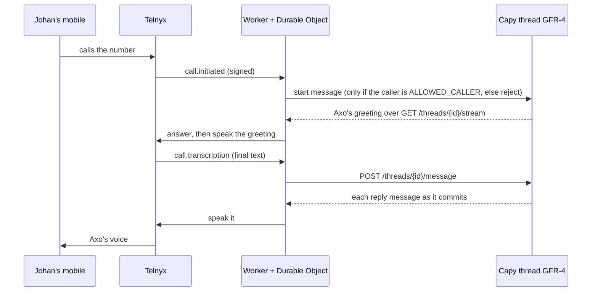

# phone-bridge (Worker g4f4r0-axo)

A Cloudflare Worker and Durable Object that lets Johan talk to Axo (thread GFR-4) by phone, and lets Axo phone Johan.
Telnyx Call Control does the audio (speech to text and text to speech), so the Worker only handles HTTPS webhooks. Every turn of a call is a message in the Capy thread, so the thread is the call history.



## Behaviour

- Inbound: only `ALLOWED_CALLER` is answered. Any other number, and anonymous callers, are rejected with a Telnyx `reject` before anything reaches Axo.
- Every webhook is verified with Telnyx's Ed25519 signature (`telnyx-signature-ed25519`, `telnyx-timestamp`, five minute replay window). A failed check returns 401 and nothing is processed.
- A call opens with a `<phone_call event="start">` message naming the caller, the local time and how to talk on the phone. The phone keeps ringing until Axo's greeting lands, so the first thing Johan hears is Axo; after `GREETING_TIMEOUT_SECONDS` (Axo can take about 10 seconds to wake) the bridge answers with "Hey Johan." and speaks Axo's greeting when it arrives.
- What Johan says is sent as `<phone_call event="speech">...</phone_call>` with `interrupt` delivery. The bridge reads the thread's live stream and speaks each assistant message the moment it commits, cleaned of markdown and links and cut at `MAX_SPOKEN_CHARS`.
- If Johan talks over Axo, playback stops, the rest of that reply is dropped, and his words go to Axo. Transcripts that match what the bridge just said are ignored as echo.
- After `IDLE_SECONDS` of silence Axo is asked to check in; after another `IDLE_SECONDS` it says goodbye and the call hangs up. When a call ends, a `<phone_call event="end">` message with the duration and who hung up is queued in the thread.
- When Axo works for `HOLD_AFTER_SECONDS` without a new message, the caller hears "One moment." (only if Axo has said nothing yet) and then looping hold music from `HOLD_MUSIC_URL`. The music stops as soon as Axo's next message lands or Johan talks. Without a music URL the bridge says "still working" every 30 seconds instead. After `REPLY_TIMEOUT_SECONDS` with no reply at all the call ends with a note that the answer will be in the thread.
- The hold music is "A cup of tea" by TAD (CC0, opengameart.org/content/lofi-compilation), served from `public/hold.mp3` as a Workers static asset.
- Hard caps: a call ends after `MAX_CALL_SECONDS` (default 600) and at most `MAX_OUTBOUND_PER_DAY` (default 10) outbound calls are placed per calendar day in `TIMEZONE`. Rejected and unauthorized attempts do not count.
- The bridge speaks every assistant message that lands in the thread after the message it sent. If another agent wakes Axo during a call, that unrelated reply is spoken too.

## Outbound calls (how Axo phones Johan)

```bash
curl -X POST https://g4f4r0-axo.<account-subdomain>.workers.dev/call \
  -H "Authorization: Bearer $OUTBOUND_TOKEN" \
  -H "Content-Type: application/json" \
  -d '{"text": "The nightly backup failed twice.", "listen": true}'
```

- `text` (required, at most 1000 characters) is spoken when Johan answers.
- `listen` (optional, default false). When true the call stays open after the alert and whatever Johan answers is sent into GFR-4 with the alert as context, then Axo's reply is spoken, turn by turn. When false the call hangs up after the alert.
- Responses: `202` call is being placed, `401` missing or wrong token (no call is placed), `400` bad body, `429` daily limit reached, `502` Telnyx refused the call.

The call always goes to `ALLOWED_CALLER`; the endpoint cannot dial anything else.

## Configuration

Plain variables live in `wrangler.toml` and can be changed per deploy:

| Variable | Default | Meaning |
| --- | --- | --- |
| `LANGUAGE` | `en` | `en` or `es`: speech recognition language, voice, fixed phrases, and the language Axo is asked to answer in |
| `MAX_CALL_SECONDS` | `600` | Hard cap on one call |
| `MAX_OUTBOUND_PER_DAY` | `10` | Hard cap on outbound calls per day |
| `HOLD_AFTER_SECONDS` | `6` | Time without a new message from Axo before hold |
| `HOLD_MUSIC_URL` | the Worker's `/hold.mp3` | MP3 or WAV looped during hold; empty disables music |
| `REPLY_TIMEOUT_SECONDS` | `300` | How long to wait for Axo before giving up |
| `MAX_SPOKEN_CHARS` | `700` | Longest reply read aloud per message |
| `CAPY_THREAD_ID` | GFR-4's id | Thread that receives the calls |
| `IDLE_SECONDS` | `20` | Silence before Axo checks in, and again before it says goodbye |
| `GREETING_TIMEOUT_SECONDS` | `20` | Longest ring before answering without Axo's greeting |
| `CALLER_NAME` | `Johan` | Name used in the start message and fallback greeting |
| `KEYTERMS` | `Axo,Capy,Johan,g4f4r0,Telnyx,Cloudflare,GitHub` | Words speech recognition is biased toward |
| `TIMEZONE` | `Europe/Madrid` | Day boundary for the outbound cap |
| `VOICE`, `STT_ENGINE`, `STT_MODEL` | per language, `Deepgram`, `deepgram/nova-3` | Telnyx voice and transcription engine overrides |
| `TELNYX_CONNECTION_ID` | set in `wrangler.toml` | Id of the Telnyx Call Control application (named g4f4r0-axo) the number is assigned to |

## Secrets

Set with `wrangler secret put <NAME>` (or through the Cloudflare API). Never commit them. A secret set before the first deploy is lost, so deploy first.

| Secret | What it is |
| --- | --- |
| `TELNYX_API_KEY` | Telnyx API v2 key |
| `TELNYX_PUBLIC_KEY` | Telnyx account public key (Mission Control, Keys and Credentials, Public Key); base64 Ed25519 |
| `CAPY_API_KEY` | Capy API key that can write to and read from the GFR-4 thread (Settings, API) |
| `TELNYX_NUMBER` | The purchased Telnyx number in E.164, used as the caller id of outbound calls |
| `ALLOWED_CALLER` | Johan's mobile in E.164, the only number that is answered and the number outbound calls go to |
| `OUTBOUND_TOKEN` | Random bearer token for `POST /call`; generate with `openssl rand -hex 32` |

## Setup and deploy

1. In Telnyx create a Call Control application (webhook API version v2) whose webhook URL is `https://g4f4r0-axo.<account-subdomain>.workers.dev/telnyx/webhook`, and assign the purchased number to it.
2. `cd phone-bridge && npm install`
3. Set `TELNYX_CONNECTION_ID` in `wrangler.toml` and put the six secrets above with `wrangler secret put`.
4. `npm run deploy`

## Development

`npm test` runs the unit tests (signature check, caller allowlist, outbound auth, caps, call flow); `npm run typecheck` checks the types.
